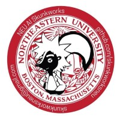

<div align="center">



# AI Skunkworks · Northeastern University

**A student-led AI research and build group. Small teams, short loops, real stakes.**

Est. 2019 · Revived January 6, 2026 · Affiliated with Humanitarians AI

[Discord](https://discord.gg/PGebZX3xU) · [Substack](https://aiskunkworks.substack.com) · [LinkedIn](https://www.linkedin.com/company/aiskunkworks/) · [Instagram](https://instagram.com/aiskunkworks) · [GitHub](https://github.com/skunkworksneu) · [Join us](https://forms.cloud.microsoft/Pages/ResponsePage.aspx?id=gcLuqKOqrk2sm5o5i5IV5z3UtEad7LFKuTRbSEyY4zhUOFpUSFE5M0QzMUg0RDExRElSMlpEMUxLSC4u)

</div>

---

## The short version

This repository is the public website for **AI Skunkworks**, Northeastern's graduate research and build unit for modern AI. It is a hand-built static site: plain HTML, CSS and vanilla JavaScript, with no framework, no bundler and no build step. Clone it, open `index.html`, and you are looking at production.

The site is designed like a classified field manual. Pages are numbered sections (`§ 01`, `§ 02`), projects are "files" with clearance tags, the crew page is an "institutional dossier", and the events page ends in a conversational intake terminal. Under the theatre is a carefully engineered front end: a token-based design system, a flash-free light/dark theme, a CSS-only animated mascot, and a canvas-free SVG animation that respects reduced-motion settings.

> *"A skunkworks project is one built by a small, loosely-structured team whose only job is radical innovation."*
> The name comes from Lockheed's secret aircraft division. Ours is the student version. No actual skunks involved.

---

## Contents

- [The site at a glance](#the-site-at-a-glance)
- [What the organization does](#what-the-organization-does)
- [Under the hood](#under-the-hood)
- [Project structure](#project-structure)
- [Running it locally](#running-it-locally)
- [Deploying](#deploying)
- [Editing guide](#editing-guide)
- [Accessibility and performance](#accessibility-and-performance)
- [Contributing](#contributing)
- [Contact](#contact)

---

## The site at a glance

| Page | Section | What a visitor finds there |
|---|---|---|
| [`index.html`](index.html) | Index | The hero with the animated circuit "twister", who we are, the three operational layers (Tooling, Research, Judgment), the four headline project files, a scrolling ticker of focus areas, partner strip, and the charter. |
| [`projects.html`](projects.html) | § 01 · Operations Dossier | The six research divisions with member counts, meeting times and method tags, followed by the active project files on the bench, including one that is still `[REDACTED]`. |
| [`manifesto.html`](manifesto.html) | § 02 · Charter Document | Why the unit exists, the eight operating tenets ("Ship the experiment, not the product", "Publish the failure"), and the six irreducible human capacities the group trains for. |
| [`people.html`](people.html) | § 03 · Crew & Institutional Dossier | About us, an expandable cohort timeline from 2019 to the 2026 revival, legacy sites, operating principles, the current team and alumni, institutional partners, HuskyStarter support, and contact. |
| [`events.html`](events.html) | § 04 · Field Operations | Upcoming and recent operations with blur-locked "tap to peek" details, the six standing event formats, and the conversational intake terminal. |

---

## What the organization does

### Six research divisions

| Division | Focus | Representative methods |
|---|---|---|
| **Causal Inference** (flagship) | What actually caused what. Includes a clinical decision-making collaboration with Mass General. | do-calculus, counterfactuals, propensity scores, DAGs, instrumental variables |
| **Explainable AI** | Making black boxes admit what they are doing. Deployment lineage to Squark.ai. | SHAP, LIME, integrated gradients, attention rollouts, model cards |
| **Visual Analytics** | Interactive tools that let domain experts see, and disagree with, what models do. | D3, Observable, interaction design, user studies |
| **ML Observability** | The unglamorous work that decides whether a model survives contact with reality. | drift detection, calibration audits, fairness monitoring, MLOps |
| **Kaggle Group** | Competition-driven learning, currently the RSNA Pulmonary Embolism Detection challenge. | PyTorch, XGBoost, feature engineering, ensembling |
| **Gauguin** | Generative art research: what makes output *good* rather than merely novel. | diffusion, GANs, aesthetic evaluation, creative coding |

### Projects on the bench

- **Hues & Tones**: a designer-developer bridge for generative palettes. RISE 2019 finalist, still iterating.
- **Pulmonary Embolism Detection**: 3D CT volumes, class imbalance and competition-grade ensembling.
- **Interpretability Toolkit**: an open-source bundle of XAI and audit methods (v0.3, public).
- **Drift Sentinel**: a real-time drift detection prototype, in internal beta against partner datasets.
- **Gauguin Studio**: internal creative-coding tooling for exhibitions and the occasional album cover.

### Events and community

Hackathons (including a planned Perplexity-sponsored Comet agentic-browser track), a speaker series, open-mic lightning talks, workshops, weekly reading groups, and partner collaborations with the Massachusetts AI Hub, Boston Tech Week, Humanitarians AI and The Open Accelerator (Red Hat × IBM × MA AI Hub).

### People

Faculty advisor **Prof. Nik Bear Brown** (Ph.D. Computer Science, UCLA) has guided every cohort since 2019. The 2026 revival is led by **Gnana Shishir Kumar** (President), **Aravind Balaji** (VP Research & Development) and **Jaisukh** (Treasurer). Full roster and alumni live on [`people.html`](people.html).

---

## Under the hood

### Zero-dependency stack

- **HTML5** pages with semantic landmarks and a shared header and footer.
- **CSS** split by responsibility (tokens, base, layout, components, one file per page).
- **Vanilla JavaScript** in small IIFE modules that exit early when their target element is not on the page.
- **One external request**: IBM Plex Sans and IBM Plex Mono from Google Fonts. Everything else is self-hosted.
- `.nojekyll` is included so GitHub Pages serves files as-is.

### Design system

All visual decisions live in [`styles/tokens.css`](styles/tokens.css) as CSS custom properties.

| Token | Value | Role |
|---|---|---|
| `--paper` | `#ffffff` | Background |
| `--ink` | `#000000` | Primary text |
| `--accent` | `#c8102e` | Northeastern red, also used for `--classified` |
| `--signal` | `#ffc72c` | Yellow highlights and the mascot's circuitry |
| `--sans` | IBM Plex Sans | All headings and body text |
| `--code` | IBM Plex Mono | Used only inside the intake terminal |

Spacing (`--space-xs` to `--space-xl`) and type (`--text-xs` to `--text-xl`, plus fluid `clamp()` sizes for pull-quotes) are tokenized too, so a rebrand is a one-file change.

### Light and dark theme

The header toggle sets `data-theme` on `<html>` and saves the choice in `localStorage` under `skunkworks-theme`. With no saved choice, the site follows the operating system preference. A tiny inline script in each page's `<head>` applies the theme before first paint, so there is no flash of the wrong theme.

### The mascot

The running skunk beside the logo is an inline SVG animated entirely in CSS (the `.skunk*` rules at the end of [`styles/components.css`](styles/components.css)). One 12-second loop: it sits by the logo, runs out along the circuit trace, sits, turns, runs home, and settles facing the logo. Visitors with reduced motion enabled see it sitting still.

### The home hero "twister"

[`scripts/twister.js`](scripts/twister.js) builds a spinning funnel of nine circuit rings with three gadget skunks spiralling up it, each kitted out with smart goggles, an LED collar, a wrist watch and a tail drone. It is pure SVG driven by `requestAnimationFrame`, with ring arcs split into back and front layers so the skunks pass convincingly through the funnel.

- Geometry and timing constants (`CX`, `TOP`, `BOTTOM`, `R_TOP`, `R_BOTTOM`, `RINGS`) sit at the top of the file.
- Styling lives under "Twister animation" in [`styles/pages-index.css`](styles/pages-index.css).
- It pauses when scrolled out of view or when the tab is hidden, and renders a still frame for reduced-motion users.

### The intake terminal

[`scripts/intake.js`](scripts/intake.js) turns the bottom of the events page into a chat-style onboarding flow. It walks a visitor through six validated steps (name, email, affiliation, division, intent, Discord handle), supports going back, shows a progress indicator, announces each step to screen readers, and finishes with a generated reference code.

Submission works in two modes:

1. **Mailto (default)**: builds a pre-filled email to `aiskunkworks@northeastern.edu`.
2. **Endpoint**: set `SUBMISSION_ENDPOINT` at the top of the file (for example a Google Apps Script web app URL) and responses are sent with `fetch`, with a retry screen on failure.

If JavaScript is disabled, a plain-text fallback tells visitors to email the unit directly.

### Other behaviour

- [`scripts/main.js`](scripts/main.js): mobile hamburger menu, cohort timeline "Expand all / Collapse all", the command tenure pills on the crew page, and the theme toggle.
- [`scripts/events.js`](scripts/events.js): blur-lock reveal buttons on event cards, with `aria-expanded` kept in sync.

---

## Project structure

```text
.
├── index.html            # Home: hero twister, layers, divisions, charter
├── projects.html         # § 01 Operations dossier
├── manifesto.html        # § 02 Charter document
├── people.html           # § 03 Crew and institutional dossier
├── events.html           # § 04 Field operations and intake terminal
├── assets/
│   ├── favicon.png
│   ├── skunkworks-logo.jpg
│   └── skunkworksneu_logo.jpg
├── scripts/
│   ├── main.js           # Nav, theme, timeline, tenure strip
│   ├── twister.js        # Home hero animation
│   ├── events.js         # Event card reveals
│   └── intake.js         # Conversational intake terminal
├── styles/
│   ├── tokens.css        # Colors, type, spacing (edit here first)
│   ├── base.css          # Resets and element defaults
│   ├── layout.css        # Header, footer, grid, sections
│   ├── components.css    # Buttons, cards, tags, mascot
│   └── pages-*.css       # One stylesheet per page
├── .nojekyll
└── .gitignore
```

---

## Running it locally

There is nothing to install. You can open any `.html` file directly, but a local server gives you correct relative paths and behaves like production.

```bash
git clone https://github.com/AravindB98/NEU_AISkunkworks_Website.git
cd NEU_AISkunkworks_Website
python3 -m http.server 8000
```

Then visit <http://localhost:8000>.

Prefer Node? `npx serve .` works just as well. On Windows, use `python` instead of `python3`.

---

## Deploying

The site is ready for **GitHub Pages** as-is:

1. Go to **Settings → Pages** in this repository.
2. Under **Build and deployment**, choose **Deploy from a branch**, then `main` and `/ (root)`.
3. Save. The site will be served at `https://aravindb98.github.io/NEU_AISkunkworks_Website/`.

Because there is no build step, any static host (Netlify, Cloudflare Pages, Vercel, an S3 bucket) also works by pointing it at the repository root.

---

## Editing guide

| I want to... | Do this |
|---|---|
| Change a brand color or font | Edit [`styles/tokens.css`](styles/tokens.css). Every page picks it up. |
| Add a project file | Copy an existing `PRJ.*` card in `projects.html` (and `index.html` if it should be featured). |
| Add an event | Copy a card in the Upcoming or Recent section of `events.html`. Reveal buttons wire themselves up. |
| Update the team | Edit the Team section of `people.html`. Move departing members to Alumni with their tenure. |
| Change the mascot | Update the SVG in **all five** HTML headers. The markup is identical in each. |
| Tune the twister | Adjust the constants at the top of `scripts/twister.js`. |
| Collect intake responses automatically | Set `SUBMISSION_ENDPOINT` in `scripts/intake.js`. |
| Change the "Join us" link | It points to the Microsoft Forms membership form from the header, home hero, crew CTA and every footer. Update all of them. |

---

## Accessibility and performance

- Every animation (mascot, twister, ticker) honours `prefers-reduced-motion`.
- The twister stops rendering when off-screen or when the tab is hidden, so it costs nothing in the background.
- Theme is applied before paint, avoiding layout and color flashes.
- Interactive elements expose `aria-expanded` and `aria-controls`, and the intake terminal announces each step.
- Core content is plain HTML and stays readable without JavaScript.

---

## Contributing

Members and collaborators are welcome to open issues and pull requests.

1. Create a branch from `main`.
2. Keep the zero-dependency spirit: no frameworks or build tools without a discussion first.
3. Put new colors and sizes in `tokens.css` rather than hard-coding them.
4. Check your change in both light and dark themes, on mobile, and with reduced motion enabled.
5. Open a pull request with a short description and a screenshot.

---

## Contact

- **Email**: [aiskunkworks@northeastern.edu](mailto:aiskunkworks@northeastern.edu)
- **Membership**: [Microsoft Forms application](https://forms.cloud.microsoft/Pages/ResponsePage.aspx?id=gcLuqKOqrk2sm5o5i5IV5z3UtEad7LFKuTRbSEyY4zhUOFpUSFE5M0QzMUg0RDExRElSMlpEMUxLSC4u)
- **Support our compute node**: [HuskyStarter campaign](https://huskystarter.northeastern.edu/campaigns/ai-skunkworks-dedicated-compute-node#/)
- **Legacy sites**: [neu-ai-skunkworks.github.io](https://neu-ai-skunkworks.github.io) · [alskunks.sites.northeastern.edu](https://alskunks.sites.northeastern.edu)

---

<div align="center">

**Read the manifesto once. Argue with it. Then come build.**

© 2026 AI Skunkworks · Northeastern University

</div>
